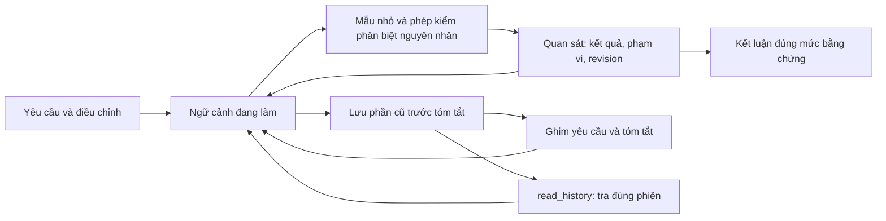

# Đánh giá Peto Agent từ phiên radio

Ngày 17/10/2026. Phạm vi: mã nguồn CLI/backend, ba nhật ký GTAIV ngày 16/10, phiên
“Mod nhạc radio thành nhạc riêng”, kiểm tra cấu trúc âm thanh và phản hồi chạy game của người dùng.

## Kết luận có bằng chứng

Không đủ cơ sở quy toàn bộ thất bại cho môi trường, model hoặc kích thước context. Peto đã đọc tệp,
chạy Python và tra web được. Vấn đề rõ hơn là chọn phép thử chưa phân biệt đúng nguyên nhân,
giữ trạng thái công việc qua tóm tắt chưa chắc chắn, và thiếu đường tra lại bằng chứng đã bỏ khỏi context.

Phạm vi hai yêu cầu khác nhau: người dùng ban đầu cho Peto chọn một đài, còn yêu cầu sau giao Codex
là thay tất cả đài. Chọn LCHC không tự nó là sai phạm vi. Kết quả Codex phát được nhạc chứng minh
cách mod này khả thi, không phải phép thử đối chứng giữa cùng một model, harness và điều kiện.

| Quan sát | Ý nghĩa | Cách xử lý trong bản sửa |
|---|---|---|
| Script Peto chọn 20 stream dài nhất: 8 bài nhạc, 10 đoạn DJ và 2 ID đài | Không phân loại đúng đối tượng thay thế; chỗ chứa âm thanh không đồng nghĩa mục nhạc trong playlist | Yêu cầu xác định kết quả quan sát được, tìm bộ đọc/tham chiếu và chứng minh một mẫu trước khi làm hàng loạt |
| Tệp Peto tạo ghép sai vị trí bảng seek kênh phải so với payload; bỏ timestamps | Có lỗi container cụ thể; chưa chứng minh riêng lỗi nào gây toàn bộ im tiếng | Kiểm tra độc lập bằng bộ giải mã/ứng dụng tiêu thụ, không chỉ tự đọc lại cùng một encoder |
| Kiểm tra DAT15 chỉ chứng minh thời lượng và tính nhất quán của tệp | Không chứng minh game đã nạp và phát nhạc | Lời nhắc kiểm tra phân biệt kiểm tra tệp, tích hợp và hành vi thực tế |
| Session cuối có 35 mục, phần lịch sử đầu chỉ còn tóm tắt 939 ký tự | Thông tin quyết định phụ thuộc bản tóm tắt; yêu cầu gốc có thể mất sau nhiều lần “làm tiếp” | Ghim yêu cầu nguyên văn trong ngân sách và lưu phần trước tóm tắt để truy hồi |
| Mã cũ tìm tin user cuối trong prefix mà không loại tóm tắt vai user | Có thể nhận bản tóm tắt nội bộ là yêu cầu người dùng | Nhận diện SUMMARY_NOTE riêng, loại khỏi việc chọn yêu cầu |
| Log chỉ giữ đầu/cuối 4.000 ký tự; session bị ghi đè sau tóm tắt | Khó kiểm toán hoặc khôi phục chi tiết cũ | Kho archive giữ văn bản/kết quả công cụ đã có; read_history phân trang trong đúng phiên |
| checked_revision ghi nhận cả lần kiểm tra thất bại hoặc xem trang | Cờ này là đã thử kiểm, không phải bằng chứng yêu cầu thành công | Gửi quan sát có classification, mã thoát và revision; prompt nêu rõ giới hạn và độ mới của bằng chứng |

Tham chiếu mã phiên cũ: `tools/radio_replace.py`, `tools/ivaud_pack.py`, `tools/apply_dat15.py`
trong thư mục GTAIV. Tham chiếu harness: `peto_agent/loop.py`, `history.py`, `tools.py` và
`backend/prompts/english.py`.

## Luồng sau cải tiến

Không thêm agent chuyên trách chỉ để có nhiều agent hơn. Khả năng explore hiện có vẫn chỉ tìm/đọc code;
công cụ read_history thuộc phiên chính. Không thay model, giới hạn ngày, trần 40 bước hay ngưỡng context.
Không mở rộng quyền chạy lệnh hoặc cho phép cài công cụ tự động.

## Kiểm chứng và giới hạn

Kết quả kiểm tra cục bộ: 524 test CLI và 73 test API/schema/đóng gói qua; bài MUS1 selftest xác nhận
bản lỗi trượt, lời giải mẫu qua. Không gọi model thật trong các phép kiểm tra này.

Đối chiếu riêng hàm tóm tắt ở HEAD trước sửa và bản mới, cùng một lịch sử mẫu và cùng hai phản hồi tóm tắt
giả không nhắc lại mục tiêu, cho kết quả:

| Sau hai lần tóm tắt | Trước sửa | Sau sửa |
|---|---|---|
| Yêu cầu gốc còn nguyên văn | Không | Có |
| Điều chỉnh của người dùng còn nguyên văn | Không | Có |
| Phản hồi “vẫn không chạy” còn nguyên văn | Không | Có |
| Số phần lịch sử đã lưu để tra lại | 0 | 2 |

Bản ghi: `.runtime/harness-review-20261017/compaction-before-after.json`. Đây là thử nghiệm hồi quy với
model giả cho riêng cơ chế tóm tắt, không phải đánh giá toàn bộ CLI cũ hoặc khả năng giải bài của model.

- Kiểm thử hồi quy việc tóm tắt hai lần, giữ yêu cầu/điều chỉnh/phản hồi thất bại, mở lại phiên và tìm lại
  lời trả lời dài cùng kết quả công cụ đầy đủ như đã lưu.
- Kiểm tra lỗi lưu archive giữ nguyên context; phân cách project/server/session; không lưu reasoning hay ảnh;
  xóa phiên chỉ xóa đúng archive của nó; lần kiểm tra trước khi sửa được đánh dấu revision cũ.
- Kiểm tra giao thức công cụ mới chỉ bật khi hai phía hỗ trợ recall; schema của CLI cũ và công cụ explore giữ nguyên.
- Thêm bài đánh giá MUS1 với consumer độc lập: bản lỗi qua roundtrip nhưng trượt kiểm ứng dụng;
  lời giải mẫu sửa cả container và playlist mới qua. Đây là kiểm tra bộ chấm, không phải lượt chạy model thật.

Các thay đổi về cách chọn phép thử và cách kết luận vẫn là chỉ dẫn cho model, không phải một bộ chứng minh
ngữ nghĩa có thể tự quyết mọi tác vụ. Những test giả không chứng minh Peto chắc chắn sẽ tự giải được lại bài GTA IV.
Cần một lượt đánh giá bằng model sau khi triển khai để đo tỷ lệ đạt, số bước, token và việc kết luận quá sớm.
Chưa gọi dịch vụ AI thật hoặc triển khai VPS trong đợt sửa mã này.

Bản 0.28.0 cần cập nhật backend và CLI. Kho archive chỉ bảo toàn nội dung từ sau cập nhật; không tái tạo được
phần lịch sử cũ đã mất. Dữ liệu vẫn chỉ nằm trên máy người dùng.
