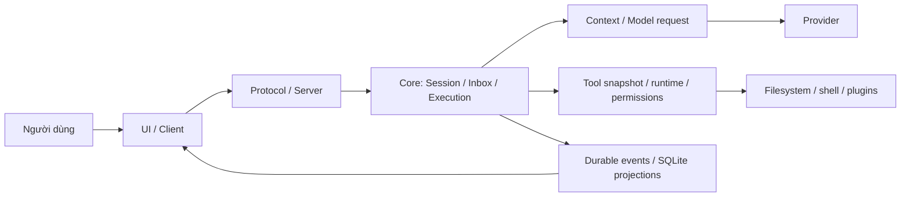
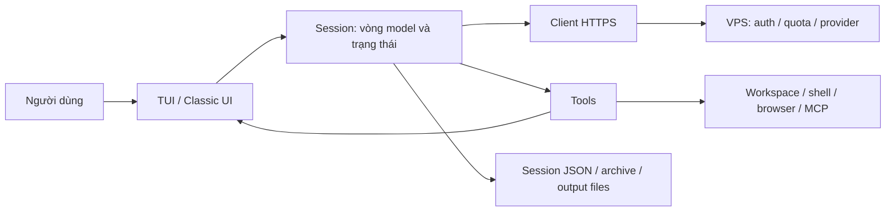

# Đối chiếu harness OpenCode và Peto

Ngày 17/10/2026. OpenCode `2.0.32`, nhánh dev, commit `22e771f5893e255ea78fc10557ed3fb98d3a1072`.
Peto đầu lượt rà: nguồn/CLI 0.28.2; bản sửa trong lượt này: **0.28.3**.

## Kết luận

Peto đã có phần lớn nhóm công cụ cần cho tác vụ coding và dữ liệu: đọc/tìm/sửa, patch, shell/lệnh nền,
quyền, kế hoạch, trình duyệt, MCP/skills, agent con chỉ đọc, snapshot, lịch sử và nén ngữ cảnh.
Điểm cần ưu tiên là **hợp đồng và vòng đời giữa các thành phần**: đầu vào được kiểm trước thực thi,
tiến độ phải lưu thành công trước bước tiếp theo, kết quả cần giữ đúng khi lỗi UI/tiến trình, và việc hoàn tất
phải gắn với bằng chứng đúng phạm vi. Thêm agent hoặc tăng context không tự sửa được những điểm đó.

Tôi đã tái hiện và sửa bốn vấn đề trong nguồn: sai kiểu tham số làm văng CLI; tiếp tục tác dụng phụ khi lưu phiên
thất bại; khôi phục phiên cũ còn lời gọi thiếu kết quả; apply_patch bỏ qua giới hạn sửa lỗi đang áp cho công cụ khác.
Các thay đổi giữ kiến trúc thực thi tại máy, Python stdlib, quyền hiện có, giới hạn ba lần kiểm tra lỗi và hạn mức model.

## Phạm vi và cách đọc nguồn

Repo MIT đã được clone vào máy với đủ nội dung 8.559 tệp của commit, lịch sử nông một commit. Giữ nguyên LICENSE;
không sửa hoặc chạy script của OpenCode. [Bản đồ đọc ngoại tuyến][reading-map] dẫn tới các nguồn quan trọng.
Đợt rà đọc mã và tài liệu OpenCode; không cài dependencies, chạy OpenCode hoặc đo chất lượng model của OpenCode.

Đối chiếu ưu tiên đường chạy thực tế: nhận yêu cầu → dựng context/schema → gọi model → nhận tool call → kiểm
tham số/quyền → thực thi → lưu kết quả → phục hồi → kết luận. Tài liệu trong Peto dẫn nhiều đường dẫn OpenCode v1;
bản clone hiện tại dùng các package Core/Schema/Protocol/Server/Client/UI tách biệt. Không dùng sự khác tên thư mục
để kết luận Peto sai; cần so trách nhiệm và các điều kiện mà mỗi ranh giới bảo đảm.

Tài liệu tham chiếu cũng cần kiểm lại bằng code. Ví dụ Session Contract nói bốn lần retry, nhưng runtime của commit
này có `Schedule.recurs(10)` và giới hạn riêng ba retry timeout; Tools Contract nói preview head/tail, còn
`tool-output.ts` thực hiện preview phần đầu theo 2.000 dòng/50 KiB. Kết luận trong báo cáo bám code thực thi tại
commit đã ghi, không dựa riêng vào văn bản thiết kế. [Retry][oc-retry], [output][oc-output].

## Hai kiến trúc đang vận hành

OpenCode V2 tách hợp đồng công khai, dữ liệu domain, điều phối/thực thi/lưu trữ và transport/UI.
Session có inbox bền vững, bước thực thi riêng với physical attempts, tool snapshot của request và event/projection.
Một call cục bộ được ghi trước khi gây tác dụng phụ; khi khởi động lại, call dở được đánh dấu thất bại, không phát lại
mù quáng. Durable identity gồm cả assistant message và call ID. [Session contract][oc-session], [step][oc-step],
[khôi phục call][oc-runner], [claim thực thi][oc-execution].

Peto đặt vòng làm việc tại máy Windows; VPS xác thực, tính bước và gọi provider. Session quản lý hội thoại trong
bộ nhớ, lưu JSON giữa các bước và gọi Tools; Tools trực tiếp gọi UI cho hiển thị và xin quyền. Đã có dataclass sự kiện
và AgentUI Protocol, nhưng chúng vẫn là lời gọi đồng bộ vào cùng renderer, chưa tạo ra sự độc lập về lỗi.
[Session Peto][peto-loop], [sự kiện][peto-events], [API Agent][peto-api].

Python và VPS là những lựa chọn phù hợp với sản phẩm hiện có. Việc cần tiếp thu từ OpenCode là ranh giới rõ giữa
trạng thái công việc, thực thi công cụ và trình bày, cùng điều kiện lưu/khôi phục có thể kiểm thử.

## So sánh harness và chức năng

| Thành phần | OpenCode tại commit tham chiếu | Peto trước/sau đợt sửa | Đánh giá |
|---|---|---|---|
| Vòng agent | Execution coordinator, runner, step và provider attempts tách biệt | Session._run điều phối nhiều trách nhiệm trong một lớp | Nên tách dần; số dòng riêng lẻ không phải bằng chứng lỗi |
| Hợp đồng tool | Codec input/output, canonical content và metadata riêng; snapshot tool theo request | Schema ở backend, handler ở CLI, UI có bảng nhãn riêng; nay có kiểm kiểu đầu vào và test chéo schema/handler | Đã sửa lỗi đầu vào; output schema/registry thống nhất còn thiếu |
| Lưu trước tác dụng phụ | Durable Tool.Called trước local execution | Đã lưu tiến độ trước tools; trước đây lỗi lưu bị bỏ qua, nay dừng trước công cụ/bước tiếp | Đã sửa điều kiện lưu; JSON chưa thành event store |
| Lời gọi dở dang | Reconcile theo assistant message/call trước runner tiếp tục | Bản 0.28.2 xử lý crash mới; 0.28.3 thêm sửa phiên cũ trong bộ nhớ, không tự phát lại | Đã bù lỗi phục hồi; chưa có durable message identity đầy đủ |
| UI bị lỗi | Client/event transport là ranh giới riêng; subscriber chậm không chặn Core | ToolCall/ToolDone vẫn được gọi trực tiếp; bản sửa cụ thể tránh KeyError, lỗi renderer khác vẫn có thể dừng core | Cần làm tiếp cơ chế quan sát độc lập với quyền tương tác |
| Nhập thêm khi đang chạy | Durable inbox, queue/steer, admission ID và thứ tự | Yêu cầu chính nay lưu trước model; steer/queue ở UI đưa vào phiên tại ranh giới bước, phần chưa vào phiên còn trong bộ nhớ | Cần inbox bền vững cho tin đang chờ khi tiến trình tắt |
| Context/compaction | Ước tính request theo cửa sổ model, headroom và recent context | Ngưỡng 180 items/200.000 ký tự; có tối ưu transport, ghim yêu cầu và archive | Giữ archive; bổ sung ngân sách theo model và số đo usage |
| Transcript đầy đủ | Durable history độc lập active history dùng cho model | Session JSON + archive trước tóm tắt; reasoning/media có giới hạn riêng | Đã có nền tảng; không coi text summary là bản sao transcript |
| Output dài | Producer capture riêng; managed storage và bounding ở runner | Spool 20 MB, preview, read_output; ghi spool thất bại có thể không còn bản đầy đủ | Cần trạng thái loss rõ hơn và retention chung cho cả tool động |
| Instruction | Content-addressed values, delta/epoch, ảnh chụp request | AGENTS scoped, digest khi sửa, user guide, skills/catalog | Peto đã có scope/freshness; version theo step còn thiếu |
| Quyền | Action/resource, allow/ask/deny, rule matching, source gắn invocation | y/n/a/s/l, exact command/cwd/shell, origin/site grants lưu ngoài repo | Khác chủ đích; giữ exact-match cho shell thay vì nới quyền cho giống |
| Shell và đường dẫn | Parser + external-directory authorization + process runtime | cwd giới hạn dự án; lệnh shell được người dùng duyệt vẫn có quyền của OS | Cả hai cần phân biệt permission với sandbox; Peto chưa có sandbox OS |
| Lệnh nền | Job/shell riêng, completion notification | Jobs, read/stop, thông báo job kết thúc | Đã có; cần test lỗi/cancel/đóng UI cùng runtime |
| Agent con | Child session có ID, tiếp tục và chạy nền, depth policy | explore chỉ đọc, fresh context, cùng model/effort thấp, 4/8/15 bước | Khác theo lựa chọn chủ tài khoản; thêm khả năng tiếp tục con sau khi nền ổn định |
| Lập kế hoạch | Agent selection + permissions | Plan mode chặn công cụ đổi tệp/thao tác; shell vẫn hỏi quyền theo chính sách | Đã có; không dùng tên mode để suy ra sandbox |
| MCP/skills | Plugin/tool catalog, snapshot, scoped registration và reload | Có MCP stdio/HTTP, bật rõ ràng; có skills dự án | Đã có; kiểm đầu ra động và catalog version còn cần làm |
| Code Mode | Catalog + execute, machine output khác model content | Gọi từng công cụ qua schema | Khả năng mở rộng sau; chưa là điều kiện sửa lỗi GTA |
| Sửa tệp | Công cụ edit/write/patch cùng contracts/permissions | Digest đọc mới nhất, CRLF/BOM, patch, diff, undo | Nền tảng tốt; sửa thiếu guard apply_patch trong đợt này |
| Snapshot/rollback | Git snapshot scoped, tuân ignore và điều kiện repository | Kho git ẩn, bỏ tệp >2 MB, symlink và tệp bị ignore | Với audio game cần backup/manifest riêng, không dựa vào snapshot mặc định |
| Browser | Desktop browser plugin, RPC/permissions và invocation riêng | Edge/CDP riêng, localhost và outside read-only, quyền origin/site | Peto đã có khả năng thực dụng; không cần thay bằng desktop OpenCode |
| LSP/diagnostics | Tool edit/write V2 còn TODO LSP tại commit này | Dựa vào build/test/shell/browser | Không gán cho OpenCode khả năng LSP hoàn chỉnh mà source chưa cho thấy |
| Fork/đa UI/SDK | Facade, API và session services phong phú | New/resume/timeline/export, API Agent nhỏ và feature negotiation | Ưu tiên sau độ bền của phiên/công cụ |
| Hạn mức | Agent step allowance và model/provider policy | Quota tài khoản ở VPS + chi phí model/effort + 40 vòng chính | Giữ chính sách Peto; tính thêm compact/title/explore khi đo tổng bước |
| Kiểm chứng hoàn tất | Runner bảo đảm vòng đời/outcome; vẫn cần model chọn phép thử đúng | Revision/check observations/reminder, evals, phản hồi người dùng | Không hệ nào tự chứng minh game đã phát đúng chỉ vì script thoát 0 |

Nguồn đọc theo từng hàng nằm trong [bản đồ đọc][reading-map]. Browser có [contract riêng][oc-browser]; LSP TODO
được ghi ngay trong [edit tool][oc-edit]. Snapshot [OpenCode][oc-snapshot] và [Peto][peto-snapshot] có phạm vi khác nhau.

## Các lỗi đã tái hiện và sửa trong 0.28.3

### 1. Tham số sai kiểu vượt qua biên gọi công cụ

Trước sửa, Tools.call chỉ kiểm object JSON và signature.bind. `start_line="1"` đi vào so sánh chuỗi/số và gây
TypeError; `timeout_seconds="20"` cũng làm văng; `depth=[]` bị nhận như mặc định. Đây là lỗi runtime ở ranh giới
model/tool, không phải bằng chứng model không thể giải tác vụ.

Thêm [tool_input.py][peto-input]: kiểm kiểu đã khai báo trước tool_started, xin quyền và thực thi; phân biệt bool
với int, giữ nullable và tương thích tham số tùy chọn lạ mang null. Trả lỗi invalid_arguments cho model tự điều chỉnh.
Kiểm kiểu dựa trên handler; đây chưa phải bản JSON Schema codec đầy đủ cho mọi cấu trúc lồng/extension như OpenCode.
Tool-specific validation vẫn xử lý giá trị, cấu trúc và giới hạn của riêng từng công cụ.

### 2. Ghi tiến độ thất bại nhưng vẫn thực thi

Fault injection làm thao tác thay tệp session thất bại: mã cũ vẫn tạo tệp theo yêu cầu và in “Xong”, không có bản
session JSON được lưu. Nay history.save báo thành công/thất bại, _save_progress dừng trước công cụ hoặc model tiếp;
finally xác nhận lưu trước tổng kết và báo lỗi khi chưa lưu được. Nếu tác dụng phụ vừa xảy ra rồi lưu kết quả lỗi,
công cụ kế tiếp bị chặn và bộ nhớ còn kết quả; bản lưu cũ vẫn đánh dấu chưa rõ kết quả. Không tuyên bố exactly-once.

Yêu cầu chính cũng được lưu trước lần gọi model đầu tiên. Trước đây phải đợi model trả một bước mới có bản tiến độ;
đóng cửa sổ trong lần chờ đầu có thể làm mất yêu cầu khỏi session. Đây là admission tối thiểu cho luồng chính,
chưa thay thế durable inbox cho toàn bộ steer/queue.

Kiểm tra toàn bộ bắt được lỗi lưu ngắn hạn trong bài đổi model liên tiếp. Probe tách riêng ghi 2.000 lần trên máy này:
117 lần os.replace trả PermissionError, errno 13/WinError 5. Chưa xác định tiến trình hoặc cơ chế nào từ chối truy cập.
Thêm atomic_file.py dùng tệp tạm riêng, thử lại tối đa ba lần với khoảng nghỉ 10/30/70 ms chỉ cho mã Windows 5/32/33.
Lỗi khác hoặc lỗi còn kéo dài vẫn trả thất bại và chặn bước tiếp. Đây là retry lưu dữ liệu, không retry tác dụng phụ
của công cụ hoặc yêu cầu model. Probe sau sửa: 2.000/2.000 lưu thành công, xử lý 52 lần từ chối ngắn hạn, không còn
tệp tạm; hai lượt đo này không phải bảo đảm một tỉ lệ lỗi cố định trên mọi máy. `atomic-probe.json` và
`atomic-probe-after.json` giữ số liệu.

### 3. Phiên cũ còn lời gọi thiếu kết quả

Thêm [session_protocol.py][peto-protocol] dùng chung khi lưu tiến độ và đọc phiên. Lời gọi thiếu kết quả được gắn
INTERRUPTED_RESULT; đánh dấu dang dở và không retry tự động. Đối chiếu theo thứ tự nên call_id dùng lại ở bước sau
không bị một kết quả cũ che khuất. Đọc phiên chỉ sửa bản trong bộ nhớ, không âm thầm ghi đè tệp gốc.
Khi vòng làm việc dừng do lỗi, cùng quy tắc áp vào bộ nhớ để yêu cầu tiếp theo trong cùng cửa sổ cũng hợp lệ.
Chuyển định dạng session cũ chỉ xóa bản cũ sau khi lưu bản mới thành công.

### 4. Giới hạn sửa lỗi không đồng đều giữa công cụ/model

Guard ba lần kiểm tra lỗi chặn edit_file/write_file/delete_file/move_file nhưng bỏ apply_patch. Probe trên mã cũ
đã ghi được tệp qua patch sau khi bộ đếm bằng 3. Nay patch chịu cùng guard. Giữ nguyên giới hạn đã được chủ tài khoản
chọn; không tự thay bằng chính sách OpenCode.

Ngoài test tái hiện, có test chéo schema backend với handler CLI cho base/all features, model patch và không patch:
khớp tên công cụ, tham số bắt buộc/được quảng bá và các kiểu JSON nguyên thủy. Đây là rào kiểm drift của hai phía,
không trao cho CLI quyền tự quảng bá hoặc mở thêm công cụ.

## Những việc cần làm tiếp theo thứ tự

| Ưu tiên | Thay đổi | Điều kiện nghiệm thu |
|---|---|---|
| P1 | Tách observer hiển thị khỏi canonical tool outcome; giữ permission là kênh tương tác bắt buộc | Renderer lỗi sau khi ghi tệp không làm mất kết quả thật; UI xin quyền lỗi thì dừng, không tự đồng ý |
| P1 | Kho state/journal cho request/step/call/result với logical step ID và assistant message ID | Kill tiến trình trước/sau side effect, resume thấy trạng thái rõ; không chạy lại thao tác chưa biết kết quả |
| P1 | Schema/codec input/output dùng chung hoặc sinh có kiểm tra; catalog snapshot theo request | Backend/CLI/plugin/UI lệch version bị phát hiện; malformed output không thành success |
| P1 | Context budget theo model và request, có headroom, usage và structured work state | Đổi model/compact nhiều lần còn nguyên yêu cầu, giả thuyết đã loại, bằng chứng và việc chưa kiểm |
| P1 | State của nghiệm thu/artifact/rollback cho tác vụ dài | Phân biệt verified-file, verified-consumer và user-confirmed; có mapping input→output và backup kiểm được |
| P2 | Durable inbox cho steer/queue, ID nhập có thể đối chiếu | Đóng CLI sau khi nhập tin chưa đưa vào model không mất hoặc nhân đôi tin khi phục hồi |
| P2 | Agent con có session/continuation và context/budget rõ | Kết quả con có nguồn, biết đã kiểm gì, dễ quay lại; không nới quyền hay tăng bước ngầm |
| P2 | Bộ chạy eval hỗ trợ đường TerminalUI thật + fault injection + cùng một case trước/sau | Đo được invalid args, UI render failure, disk failure, mạng ngắt, nén nhiều lần và semantic acceptance |
| P3 | Code Mode, SDK, nhiều UI và catalog plugin phong phú hơn | Thực hiện khi có tác vụ đo được lợi ích và nền lifecycle đã ổn định |

Đích tách module Peto hợp lý: SessionCoordinator điều phối; SessionStore/Protocol lưu và phục hồi; ToolRuntime kiểm
input/quyền/thực thi/outcome; ContextBuilder dựng request theo khả năng model; Presenter chỉ quan sát, PermissionBroker
xử lý quyết định của người dùng. Các adapter Windows/browser/MCP và VPS hiện có tiếp tục làm nhiệm vụ của mình.
Có thể triển khai từng ranh giới bằng Python, chưa cần chuyển toàn bộ sang bộ công nghệ của OpenCode.

Kho journal ở giai đoạn tiếp theo cần giữ nội dung canonical hoặc tham chiếu đầy đủ tới output đã lưu. Nhật ký xem
nhanh hiện cắt đầu/cuối không đủ làm nguồn sự thật cho execution. Giữ đầy đủ transcript và giới hạn phần gửi model
là hai trách nhiệm khác nhau; archive cũng không tái tạo được bytes mà producer đã bỏ trước khi trả kết quả.
Việc phục hồi ghi trạng thái dở dang không có nghĩa Peto tiếp tục chạy khi CLI đã đóng hoặc tự khởi động tác vụ lại.

## Điều kiện trước lần thử GTA IV tiếp theo

Phiên GTA cũ có lỗi chọn đối tượng nhạc và định dạng container, đồng thời chưa chứng minh bằng game trước khi áp
dụng rộng; phiên C# mới phơi bày lỗi UI/tool lifecycle. [Phân tích phiên radio][radio-review] và [sự cố read_output][ui-review]
giữ các bằng chứng cụ thể. Kết quả toy eval 20 bài/23 đài trước đây là một lần đạt trong môi trường có đặc tả/bộ đọc;
không dùng nó làm đối chứng rằng các thay đổi mới chắc chắn giải lại GTA IV.

Đề xuất bài thử kế tiếp dùng bản staging riêng cùng dữ liệu và điều kiện đầu vào cố định, có manifest cho đủ
20 nguồn, playlist của mọi đài/episode, checksum backup và đường rollback. Peto phải phân biệt bài nhạc với DJ/jingle,
chứng minh một stream bằng decoder/consumer độc lập trước, rồi mới đóng gói hàng loạt. Giữ phản hồi của người dùng
“không chạy” cùng những giả thuyết đã bị loại qua các lần nén; báo đúng mức đã kiểm thay vì dùng mã thoát 0 làm nghiệm thu.

Sau kiểm cấu trúc/giải mã và cách game chọn metadata, cần nghe trong game để xác nhận runtime. Chỉ đánh dấu phần đã
được thử; phản hồi vài đài không đồng nghĩa đã kiểm toàn bộ đài, vòng lặp và DLC. Với tệp âm thanh lớn, rollback dựa
vào backup riêng đã kiểm checksum, vì snapshot CLI bỏ qua tệp trên 2 MB.

Đợt này không gọi model, chạy lại GTA hoặc triển khai VPS. Bản 0.28.3 nằm ở nguồn; máy Peto đã vá trước đó vẫn là
0.28.2 cho tới khi cập nhật gói.

## Hồ sơ kiểm chứng

- Baseline diff và metadata: `.runtime/peto-opencode-review-20261017/`.
- Probe trước sửa: `arguments-before.json`, `save-failure-before.json`, `patch-budget-before.json`.
- Regression/contract test: [test_harness_boundaries.py][boundary-tests].
- **570 test CLI qua** trong lượt cuối, 201,44 giây, gồm 27 test mới về các ranh giới đang sửa.
- **5 test gói cài qua**; tổng 575 kiểm tra. Gói vẫn lấy đúng phiên bản và chứa các module mới.
- OpenCode checkout không có thay đổi; `git diff --check` của Peto qua.
- Các probe và test dùng dữ liệu giả trong workspace; số lượt gọi model thật trong đợt này: **0**.

[reading-map]: C:/Users/binhb/Downloads/Peto-Web/agent-cli/docs/opencode-reading-map.md
[oc-session]: C:/Users/binhb/Downloads/Peto-Web/.runtime/references/opencode/specs/v2/session.md
[oc-step]: C:/Users/binhb/Downloads/Peto-Web/.runtime/references/opencode/packages/core/src/session/runner/step.ts:104
[oc-runner]: C:/Users/binhb/Downloads/Peto-Web/.runtime/references/opencode/packages/core/src/session/runner/llm.ts:362
[oc-execution]: C:/Users/binhb/Downloads/Peto-Web/.runtime/references/opencode/packages/core/src/session/execution.ts:76
[oc-retry]: C:/Users/binhb/Downloads/Peto-Web/.runtime/references/opencode/packages/core/src/session/runner/retry.ts:47
[oc-output]: C:/Users/binhb/Downloads/Peto-Web/.runtime/references/opencode/packages/core/src/tool-output.ts:67
[oc-browser]: C:/Users/binhb/Downloads/Peto-Web/.runtime/references/opencode/packages/plugin-browser/README.md
[oc-edit]: C:/Users/binhb/Downloads/Peto-Web/.runtime/references/opencode/packages/core/src/tool/plugin/edit.ts:205
[oc-snapshot]: C:/Users/binhb/Downloads/Peto-Web/.runtime/references/opencode/packages/core/src/snapshot.ts:114
[peto-loop]: C:/Users/binhb/Downloads/Peto-Web/agent-cli/peto_agent/loop.py
[peto-events]: C:/Users/binhb/Downloads/Peto-Web/agent-cli/peto_agent/events.py
[peto-api]: C:/Users/binhb/Downloads/Peto-Web/backend/features/agent/api.py
[peto-snapshot]: C:/Users/binhb/Downloads/Peto-Web/agent-cli/peto_agent/snapshot.py:30
[peto-input]: C:/Users/binhb/Downloads/Peto-Web/agent-cli/peto_agent/tool_input.py
[peto-protocol]: C:/Users/binhb/Downloads/Peto-Web/agent-cli/peto_agent/session_protocol.py
[boundary-tests]: C:/Users/binhb/Downloads/Peto-Web/agent-cli/tests/test_harness_boundaries.py
[radio-review]: C:/Users/binhb/Downloads/Peto-Web/agent-cli/docs/harness-review-2026-10-17.md
[ui-review]: C:/Users/binhb/Downloads/Peto-Web/agent-cli/docs/peto-read-output-crash-2026-10-17.md
