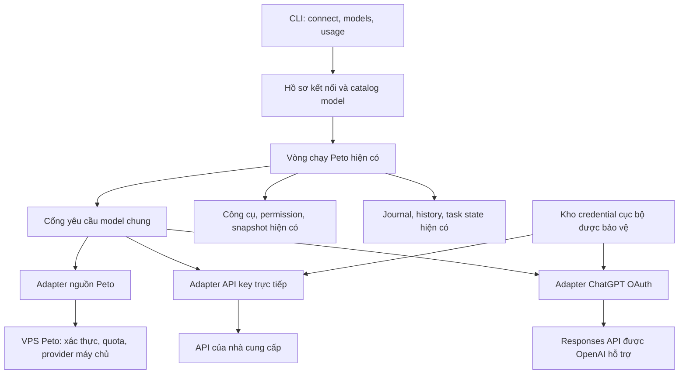

# Lộ trình nhiều nguồn model cho Peto Agent — bàn giao cho Claude

Ngày lập: 20/10/2026. Trạng thái: **kế hoạch triển khai, chưa triển khai tính năng**.

Mục tiêu cuối: người dùng đang làm một task trong Peto có thể kết nối nguồn model riêng, chọn model và tiếp tục cùng session. Nguồn Peto hiện tại tiếp tục hoạt động với quyền và hạn mức hiện có. Nguồn dùng API key riêng hoặc gói ChatGPT của người dùng có xác thực, hạn mức và cách tính phí riêng.

## 1. Chỉ dẫn bắt đầu cho Claude

Khi được giao triển khai kế hoạch này:

1. Đọc `CLAUDE.md`, kiểm tra thay đổi đang có trong workspace và đối chiếu lại các điểm vào ở mục 3. Baseline dưới đây giúp định vị, không thay thế việc đọc mã hiện tại.
2. Làm M0 rồi M1 theo thứ tự. Mỗi mốc tạo một thay đổi có thể review và kiểm chứng độc lập; tiếp tục mốc kế tiếp khi tiêu chí của mốc trước đạt. Không cần chờ duyệt lại từng lựa chọn triển khai thông thường trong phạm vi đã giao.
3. Giữ lộ trình ba giai đoạn: nền tảng → kết nối API key → trải nghiệm và ChatGPT OAuth. Bổ sung nguồn mới sau khi một nguồn đã chạy hết luồng công việc thật.
4. Ghi tiến độ và bằng chứng vào mục 12: tệp đã thay đổi, kiểm thử đã chạy, kết quả, hạn chế, bước tiếp theo. Phân biệt rõ mock, kiểm tra giao thức và kiểm tra với tài khoản thật.
5. Tôn trọng quy trình commit/deploy của chủ dự án. Việc lập tài liệu này chỉ tạo kế hoạch; không có nghĩa mã ứng dụng đã được thay đổi hoặc bản mới đã được phát hành.

Điểm cần giải quyết ngay từ đầu: **CLI hiện phụ thuộc VPS không chỉ để gọi model, mà còn để dựng prompt, chọn schema công cụ, cung cấp metadata và kiểm tra hạn mức.** Thêm nút đăng nhập hoặc thêm endpoint sẽ chưa đáp ứng được mục tiêu tiếp tục công việc bằng nguồn riêng.

## 2. Kết quả người dùng cần nhận được

Luồng nghiệm thu chính:

1. Người dùng mở một session Peto đang làm dở.
2. Chạy `/connect`, chọn OpenAI rồi nhập API key, hoặc chọn Continue with ChatGPT khi đường OAuth đủ điều kiện và đã sẵn sàng.
3. Hoàn tất xác thực; Peto hiển thị tài khoản và nguồn tính usage đang dùng.
4. Chạy `/models`, tìm và chọn model thuộc kết nối đó.
5. Tiếp tục task với yêu cầu, kết quả công cụ, kế hoạch và tiêu chí nghiệm thu đã có.
6. Đóng rồi mở lại Peto vẫn tìm được session và kết nối; token được làm mới khi cần.
7. Hết bước Peto không ngăn nguồn riêng hoạt động. Hết hạn mức nguồn riêng thì giữ nguyên công việc và thông báo đúng nguồn đang giới hạn.

Phạm vi đợt này là **Agent CLI**. Tái sử dụng vòng chạy, công cụ, permission, journal, snapshot, inbox, task state và compact hiện có. Web Chat, Companion, desktop app mới, daemon, execution isolation và việc chép toàn bộ danh sách integration của OpenCode là các hướng riêng.

Các quyền chạy lệnh đã được chủ dự án chọn không thay đổi chỉ vì thêm provider. Không đưa lại trần cứng 40 bước. Việc model gọi được công cụ vẫn phải đi qua bộ thực thi và permission của Peto.

## 3. Baseline và bản đồ mã hiện tại

Đối chiếu tại commit Peto `b207e88cfed570ec5e3733ec15dc7add98ebcd99`, CLI source `0.30.0`.

| Phần | Điểm vào hiện có | Ý nghĩa khi triển khai |
|---|---|---|
| Khởi động, `/model`, `/usage`, đăng nhập | [__main__.py](C:/Users/binhb/Downloads/Peto-Web/agent-cli/peto_agent/__main__.py) | Khởi động session đang yêu cầu `/api/agent/me`; model, effort và feature lấy từ máy chủ. Cần cho phép khởi động bằng nguồn trực tiếp. |
| HTTP/SSE tới Peto | [client.py](C:/Users/binhb/Downloads/Peto-Web/agent-cli/peto_agent/client.py) | Ràng buộc origin, token Peto và event protocol hiện tại. Không mở rộng tùy tiện client này để gửi cùng token tới provider khác. |
| Vòng chạy và các lượt phụ | [loop.py](C:/Users/binhb/Downloads/Peto-Web/agent-cli/peto_agent/loop.py), [subagent.py](C:/Users/binhb/Downloads/Peto-Web/agent-cli/peto_agent/subagent.py) | Work, compact, title, `/btw`, wrapup và explore đều có chỗ gọi thẳng `/api/agent/step`. Phải kiểm kê toàn bộ. |
| Prompt và bộ công cụ gửi lên model | [api.py](C:/Users/binhb/Downloads/Peto-Web/backend/features/agent/api.py), [tools.py](C:/Users/binhb/Downloads/Peto-Web/backend/features/agent/tools.py), [prompts/agent.py](C:/Users/binhb/Downloads/Peto-Web/backend/prompts/agent.py), [prompts/providers.py](C:/Users/binhb/Downloads/Peto-Web/backend/prompts/providers.py) | Máy chủ dựng instructions, feature negotiation, tool schema và biến thể theo model. Nguồn trực tiếp cần các thành phần tương đương ở CLI. |
| Model và quyền dùng nguồn Peto | [models.py](C:/Users/binhb/Downloads/Peto-Web/backend/ai/models.py) | Hiện các key `peto/luna/terra/sol/haiku/sonnet` gắn với quyền dùng và billing máy chủ. Không suy diễn quyền nguồn riêng từ các key này. |
| Adapter phía máy chủ | [ai/agent.py](C:/Users/binhb/Downloads/Peto-Web/backend/ai/agent.py) | Đã có luồng xAI/OpenAI/Claude và output cho CLI. Giữ hoạt động này khi bọc nguồn Peto vào abstraction mới. |
| Ngân sách context | [budget.py](C:/Users/binhb/Downloads/Peto-Web/agent-cli/peto_agent/budget.py), [backend budget.py](C:/Users/binhb/Downloads/Peto-Web/backend/features/agent/budget.py) | Đã có usage anchor, metadata context và giới hạn transport; mở rộng theo model/route thay vì viết lại compact. |
| Lịch sử và độ bền | [history.py](C:/Users/binhb/Downloads/Peto-Web/agent-cli/peto_agent/history.py), [journal.py](C:/Users/binhb/Downloads/Peto-Web/agent-cli/peto_agent/journal.py), [context.py](C:/Users/binhb/Downloads/Peto-Web/agent-cli/peto_agent/context.py) | Có `model_identity`, opaque reasoning, grouping công cụ, request intent và recovery. Khóa session hiện còn có server; cần tương thích khi đổi nguồn. |
| Thực thi công cụ | [peto_agent/tools.py](C:/Users/binhb/Downloads/Peto-Web/agent-cli/peto_agent/tools.py) | Giữ handler, validate arguments, snapshot và permission làm điểm thực thi duy nhất. |
| Cấu hình và gợi ý lệnh | [config.py](C:/Users/binhb/Downloads/Peto-Web/agent-cli/peto_agent/config.py), [commands.py](C:/Users/binhb/Downloads/Peto-Web/agent-cli/peto_agent/commands.py), [command_catalog.json](C:/Users/binhb/Downloads/Peto-Web/agent-cli/peto_agent/command_catalog.json) | Tách thông tin kết nối không bí mật khỏi credential. `catalog.py` hiện là catalog lệnh, không phải catalog model. |
| Đóng gói | [pyproject.toml](C:/Users/binhb/Downloads/Peto-Web/agent-cli/pyproject.toml), [install.py](C:/Users/binhb/Downloads/Peto-Web/backend/features/agent/install.py) | CLI hiện Python 3.12+, không dependency runtime; danh sách package đang khai báo tường minh. Thêm subpackage/tài nguyên phải sửa build và kiểm tra wheel thật. |

Giữ các quyết định mới trong [context-budget-0.30.0.md](C:/Users/binhb/Downloads/Peto-Web/agent-cli/docs/context-budget-0.30.0.md) và [durable-runtime-0.29.0.md](C:/Users/binhb/Downloads/Peto-Web/agent-cli/docs/durable-runtime-0.29.0.md). Các mục lịch sử trong `CLAUDE.md` có thể chưa cập nhật hết; ví dụ key `sol` hiện trỏ tới `gpt-6.1-sol`.

## 4. Kiến trúc đích đề xuất

Đây là hướng thiết kế cho Peto, không phải mô tả mọi chi tiết nội bộ OpenCode.

### 4.1. Ranh giới trách nhiệm

- **Runtime** giữ task, công cụ, request intent, cancellation và recovery; không chọn URL hoặc cách refresh token.
- **Adapter nguồn Peto** giữ `/me`, feature negotiation, SSE và luật thu/hoàn bước trên VPS như hiện tại.
- **Adapter trực tiếp** dựng request theo route, xác thực tới provider, chuẩn hóa kết quả và lỗi; không gọi bộ thu bước Peto.
- **Catalog** cung cấp metadata, provenance và trạng thái khả dụng; có model trong catalog không đồng nghĩa tài khoản được dùng.
- **Credential store** chỉ đưa bí mật cho thành phần xác thực/transport cần dùng; session và journal chỉ lưu tham chiếu kết nối không bí mật.
- **Prompt/tool bundle cục bộ** cho phép nguồn trực tiếp hoạt động mà không phải gọi VPS cho mỗi lượt.

Đề xuất đặt các module mới trong `C:/Users/binhb/Downloads/Peto-Web/agent-cli/peto_agent/providers/`, gồm contract, registry, catalog, adapter Peto, adapter Responses API key và adapter ChatGPT. Có thể dùng tên khác nếu khớp quy ước dự án; tránh tạo framework plugin tổng quát ngay trong đợt đầu.

### 4.2. Các dữ liệu cần tách

| Khái niệm | Dữ liệu chính |
|---|---|
| Provider definition | ID ổn định, giao thức/route, endpoint, auth method, capability của route. |
| Connection profile | ID kết nối, provider, tài khoản/workspace đã xác minh, endpoint và tham chiếu credential; không chứa secret trong bản xuất. |
| Model specification | ID trong catalog, ID thực gửi API, tên hiển thị, context/input/output, effort, công cụ và media hỗ trợ, giá nếu biết, nguồn metadata và thời điểm cập nhật. |
| Selection | Provider + connection + model + effort của session; cấu hình mặc định cho session mới được lưu riêng. |
| Usage | Nguồn thanh toán, token và request theo purpose; thông tin hạn mức chỉ hiển thị khi nguồn thực sự cung cấp. |

Phải phân biệt `peto/sol` dùng billing máy chủ với model cùng tên qua API key cá nhân hoặc ChatGPT. Quyền owner-only của nguồn Peto vẫn kiểm ở máy chủ; không áp quy tắc đó cho tài khoản riêng của người dùng và cũng không cho client tự mở quyền nguồn Peto.

Không coi giá chưa biết là 0. Chỉ ghi Free khi có bằng chứng về chi phí của route; không suy ra hạn mức vô hạn. Không hardcode chương trình miễn phí của OpenCode vào chính sách kinh doanh Peto.

### 4.3. Contract yêu cầu và sự kiện

Định nghĩa một cổng yêu cầu model phục vụ mọi purpose: `work`, `compact`, `title`, `btw`, `wrapup`, `explore`. Contract phải mang selection đã resolve, lịch sử, feature/tool profile, budget, cancellation và purpose.

Trong lần refactor đầu, ưu tiên giữ item hội thoại kiểu Responses hiện có và bọc codec tại biên adapter. Chỉ đổi định dạng lưu trữ khi có nhu cầu đã chứng minh và migration rõ ràng.

Sự kiện chuẩn hóa cần biểu đạt:

- bắt đầu lượt và metadata budget/billing;
- phần văn bản/suy luận tóm tắt để hiển thị;
- tool call hoàn chỉnh đã được kiểm tra cấu trúc;
- kết quả terminal thành công kèm output/usage;
- thất bại, chưa hoàn tất hoặc bị hủy, có phân loại và trạng thái đã phát output hay chưa.

Có thể giữ tên event hiện tại để giảm ảnh hưởng renderer. Adapter không được biến EOF thành thành công, không trả tool call từ JSON còn dang dở và không để UI exception làm mất kết quả đã lưu bền.

## 5. Các mốc triển khai

| Giai đoạn | Mốc | Kết quả bàn giao |
|---|---|---|
| 1. Nền tảng | M0 — khảo sát và chốt ranh giới | Bản đồ dependency, quyết định đường chạy trực tiếp, điều kiện ChatGPT và baseline kiểm thử. |
| 1. Nền tảng | M1 — tách cổng yêu cầu | Nguồn Peto chạy qua abstraction mới, hành vi hiện tại được giữ. |
| 1. Nền tảng | M2 — context và session qua nhiều nguồn | Selection, metadata, chuyển nguồn và resume có contract rõ ràng. |
| 2. Kết nối | M3 — API key và prompt/tool bundle cục bộ | Một nguồn riêng chạy được task trọn vẹn mà không lệ thuộc quota/VPS Peto. |
| 3. Trải nghiệm | M4 — `/connect`, `/models`, `/usage` | Người dùng quản lý kết nối và nhận biết nguồn đang dùng. |
| 3. ChatGPT | M5 — OAuth và ChatGPT plan usage | Đăng nhập, lấy model theo tài khoản, gọi model, refresh và ngắt kết nối. |
| 3. Hoàn thiện | M6 — nghiệm thu và phát hành | Kiểm thử xuyên suốt, tài liệu, migration, đóng gói và phương án quay lại. |

M0–M2 nên giữ nhỏ và tập trung nguồn Peto. M3 bắt đầu với **OpenAI Responses bằng API key riêng**, vì có thể đối chiếu với luồng hiện có. API tương thích Chat Completions, Anthropic, Google, Copilot, OpenRouter, local model và gateway khác được bổ sung theo nhu cầu sau khi vertical slice này ổn định.

### M0. Khảo sát và quyết định kỹ thuật

Việc cần làm:

1. Kiểm kê tất cả chỗ gọi `/me`, `/step`, giả định model key, step cost, feature và model identity. Bao gồm title thread, `/btw`, compact, explore và resume.
2. Ghi rõ nguồn prompt/schema và capability nào đang nằm trên VPS; liệt kê phần cần đóng gói vào CLI cho direct mode.
3. Chốt cách phân phối prompt/tool bundle dùng chung: một nguồn duy nhất, version và parity test. Hướng ưu tiên là nguồn Python thuần không phụ thuộc FastAPI/DB, có build tạo tài nguyên CLI xác định được; không duy trì hai bản copy bằng tay.
4. Chốt credential backend và cơ chế kiểm tra chữ ký OIDC. Nếu cần dependency mật mã/JOSE được duy trì, ghi lý do, phiên bản và ảnh hưởng installer; không tự viết bộ mật mã hoặc bỏ xác minh để giữ stdlib-only.
5. Xác minh loại triển khai Peto có đủ điều kiện dùng ChatGPT plan usage: mã nguồn mở/cục bộ hay dịch vụ riêng/thu phí/host từ xa. Repo OpenCode có MIT không tự cấp điều kiện này cho Peto. Tra tài liệu OpenAI hiện hành trước khi công bố hỗ trợ OAuth.
6. Chạy các bộ kiểm thử hiện có liên quan để có baseline. Không lấy số test trong ghi chú cũ làm kết quả của lần chạy mới.

Hoàn thành khi: có quyết định ngắn về đường chạy, lưu credential, prompt/schema, identity/migration và điều kiện OAuth; các quyết định có tệp đích và kiểm thử đi kèm. Chưa xác minh được điều kiện OAuth chỉ chặn phát hành M5, các mốc nguồn Peto/API key vẫn tiến hành được.

### M1. Tách cổng yêu cầu, giữ nguồn Peto hoạt động

Việc cần làm:

- Tạo contract selection, request, event, usage và lỗi; dùng adapter Peto làm triển khai đầu tiên.
- Chuyển mọi lượt model qua cùng cổng, gồm client riêng đang dùng trong title thread. Giữ snapshot request bất biến để thay model ở UI không làm một stream đổi nguồn giữa chừng.
- Resolve nguồn một lần cho mỗi logical request; log tham chiếu provider/model/connection/purpose đã lọc secret.
- Giữ shape `/api/agent/step`, rules feature negotiation và cơ chế thu/hoàn bước của client/server cũ. Nếu thêm trường, dùng thương lượng phiên bản thay vì bắt server cũ phải hiểu.
- Chuẩn hóa lỗi theo nhóm: authentication, permission, quota, rate limit tạm thời, context overflow, capability, network, canceled, partial/incomplete. Preserve code/status/request ID cho chẩn đoán nhưng lọc dữ liệu nhạy cảm.

Hoàn thành khi:

- Work + tool + work, compact, title, `/btw`, wrapup và explore bằng nguồn Peto vẫn đạt kiểm thử hiện có.
- Cancellation đóng transport; recovery và tool result commit vẫn đúng thứ tự.
- Không thay model mặc định, quyền tài khoản, số bước thu hoặc permission vì refactor.

### M2. Model metadata, chuyển nguồn và resume

Việc cần làm:

- Bổ sung selection có provider/connection/model; map key cũ sang nguồn Peto mà không đổi ý nghĩa các key hiện có.
- Mở rộng budget tracker: metadata theo model và route, tính cả instructions/tools, kiểm tra token và transport độc lập. Unknown metadata dùng ngân sách bảo thủ, có nhãn ước tính.
- Model identity phải đủ phân biệt route, model thực và phạm vi tương thích của opaque state. Chỉ giữ reasoning mã hóa/chữ ký khi adapter xác nhận tương thích; đổi tài khoản hoặc route mặc định bỏ opaque state khỏi request mới.
- Giữ toàn bộ canonical history/journal. Projection gửi model giữ user request, tool call/result, task state và acceptance; không tạo summary thay thế khi không cần.
- Chuyển model tại ranh giới an toàn sau khi tool batch đang chạy đã ghi nhận xong. Không thay nguồn của tool pending hoặc làm chạy lại lệnh có side effect.
- Xử lý trường hợp model mới có cửa sổ nhỏ hơn: preflight và compact bằng nguồn mới nếu cần. Thất bại phải giữ nguyên archive và task state; không cắt im lặng yêu cầu người dùng.
- Giữ stable session ID khi đổi provider. Thiết kế namespace cho session trực tiếp và đường đọc session cũ có server; không làm session cũ biến mất hoặc nhập lẫn tài khoản.
- Migrate config/history/journal theo phiên bản, atomic và có khả năng kiểm tra; bản cũ gặp định dạng chưa hiểu phải báo rõ, không ghi đè.

Hoàn thành khi: mở được session cũ, đổi nguồn/model, compact, đóng/mở lại và tiếp tục mà không mất kết quả công cụ, không lặp side effect và không gửi opaque state không tương thích.

### M3. Nguồn API key trực tiếp và loại bỏ phụ thuộc VPS ở direct mode

Việc cần làm:

1. Thêm hồ sơ OpenAI API key; tách secret store khỏi `config.json`, lịch sử, export và project files.
2. Dùng transport riêng cho provider: endpoint và origin của credential phải ràng buộc với hồ sơ; không theo redirect mang token sang host khác. Giữ khả năng hủy nhanh trên Windows.
3. Triển khai Responses streaming, parser và tool codec có giới hạn kích thước; chuẩn hóa usage/error vào contract M1.
4. Đóng gói prompt/tool bundle đã chốt ở M0. Dựng prompt theo purpose, model/route và khả năng tool handler cục bộ; không import backend có DB/env/runtime side effect vào CLI.
5. Feature của direct mode lấy từ khả năng CLI thực có, bundle tương thích và route. Feature của nguồn Peto tiếp tục thương lượng với server. Tool chỉ được quảng bá khi có handler, argument validation và permission tương ứng.
6. Bỏ phụ thuộc bắt buộc vào login Peto và `/me` khi người dùng chọn nguồn trực tiếp. Update notice hoặc usage Peto bị lỗi không được chặn direct mode.
7. Work, compact, title, `/btw`, wrapup và explore đều dùng nguồn đã resolve. Lượt phụ không được âm thầm gọi VPS hoặc API key của chủ web.
8. Model không hỗ trợ một native tool thì loại capability đó trước khi gửi. Native web search của VPS và công cụ cục bộ cần phân biệt; không quảng bá tính năng chưa triển khai.

Hoàn thành khi:

- Với Peto steps = 0, nguồn riêng vẫn thực hiện được vòng đọc → sửa → chạy kiểm tra → trả kết quả.
- Với VPS Peto không kết nối được, CLI có kết nối trực tiếp hợp lệ vẫn khởi động/resume và chạy được các purpose cần thiết.
- Kiểm thử kiểm tra **số request tới VPS bằng 0** trong direct workflow, không chỉ kiểm tra kết quả cuối.
- Lỗi API key/hết tiền được phân loại là của nguồn riêng, không hiện lời nhắc login Peto.
- Wheel cài trong môi trường sạch chứa đủ module, prompt và schema mới.

### M4. Trải nghiệm `/connect`, `/models` và `/usage`

Việc cần làm:

- `/connect`: xem nguồn đã hỗ trợ, thêm tài khoản, đổi kết nối đang dùng, ngắt kết nối. Input secret không echo, không vào command history; không bắt người dùng dán token vào slash command.
- `/models`: tìm theo tên/provider, lọc nguồn khả dụng, yêu thích/gần đây, trạng thái model và effort hợp lệ. Giữ `/model` và key cũ tương thích.
- Đổi model trong session không tự sửa default cho session mới. Có thao tác riêng để đặt mặc định.
- Header/footer hiện tên model và nguồn: tài khoản Peto, API key riêng hoặc ChatGPT plan. Ghi nhận tài khoản/workspace bằng thông tin phù hợp, không in token.
- `/usage`: tách bước Peto, token của session và usage nguồn riêng. Token cục bộ không phải số dư quota chính thức; dùng nhãn ước tính khi cần.
- Không chọn account/model khác âm thầm khi model đã lưu mất quyền. Thông báo lý do và để người dùng chọn nguồn tiếp tục.
- Cache catalog theo connection/account/workspace; refresh khi đổi tài khoản, không hiển thị inventory của tài khoản trước.
- Luồng terminal thường và noninteractive cần đường cấu hình có tài liệu; không bắt mọi test/automation dùng full-screen picker.

Hoàn thành khi: từ CLI người dùng kết nối key, chọn model, tiếp tục session, đặt mặc định và ngắt kết nối được; help, completion và catalog lệnh thống nhất. Chuỗi UI/lỗi/log viết tiếng Việt, system prompt giữ tiếng Anh theo quy ước dự án.

### M5. Continue with ChatGPT và dùng hạn mức ChatGPT

Mục này chỉ bật khi đã xác minh điều kiện tích hợp. Dùng tên ứng dụng Peto và đăng ký của Peto; không mượn client ID, credential hoặc danh tính OpenCode/Codex legacy.

**Đăng nhập.** Triển khai OAuth qua trình duyệt với PKCE, state, nonce, callback loopback và thời hạn chờ. Tạo host ID ổn định; lưu client ID được cấp theo tài khoản/workspace. Xác minh chữ ký và claims ID token trước khi kích hoạt kết nối. Phân biệt đăng nhập thành công với quyền dùng plan qua scope được cấp. Nguồn: [Registration and sign-in](https://developers.openai.com/siwc/token-sharing-open-source/sign-in).

**Đường inference riêng.** Dùng catalog theo tài khoản và Responses endpoint công khai được hỗ trợ. Request phải theo hợp đồng ChatGPT hiện hành: streaming, không lưu server, chờ terminal success; EOF/failed/incomplete không thành done. Nguồn: [Models and inference](https://developers.openai.com/siwc/token-sharing-open-source/models-and-inference).

**Khác biệt với API key.** Bộ encode request cho ChatGPT phải có allowlist riêng. Theo tài liệu tại ngày lập kế hoạch, route này không nhận `max_output_tokens` và `previous_response_id` qua HTTP; tool function/custom có quy tắc namespace/`additional_tools`. Giữ dự toán context ở runtime nhưng không gửi tham số bị cấm. Kiểm tra lại tool schema và capability thực tế trước triển khai. Nguồn: [Preview limitations](https://developers.openai.com/siwc/token-sharing-open-source/preview-limitations).

**Vòng đời credential.** Lưu token được bảo vệ, refresh tuần tự theo từng profile, cập nhật bộ token mới atomic; ngắt kết nối thực hiện revoke và xóa local đúng trạng thái. Không xóa credential vì lỗi mạng tạm thời. Nguồn: [Accounts and sessions](https://developers.openai.com/siwc/token-sharing-open-source/profiles-and-sessions).

**Lỗi có hành động rõ ràng.** Phân biệt thiếu consent, không đủ điều kiện, hết hạn mức, giới hạn riêng cho app, route/capability sai và refresh hết hiệu lực. Không lặp đăng nhập để chữa lỗi quota, không tự chuyển sang API key tính phí. Nguồn: [Errors and recovery](https://developers.openai.com/siwc/token-sharing-open-source/errors-and-recovery).

Việc tích hợp vào Peto:

- Khi nhận được kết nối đã xác minh, đăng ký nó vào registry M1 và picker M4; không tạo vòng chạy agent thứ hai.
- Catalog phải hiển thị model tài khoản thực dùng được, không lấy toàn bộ danh sách GPT tĩnh làm entitlement. Đổi account làm hết hiệu lực cache và usage anchor tương ứng.
- Chỉ khai báo UI đã kết nối dùng plan khi scope và route hợp lệ. Identity-only phải có trạng thái riêng.
- Lưu secret bằng kho credential của M3. Windows ưu tiên DPAPI/Credential Manager dưới tài khoản người dùng; nền tảng khác dùng kho hệ điều hành hoặc backend đã được thẩm định. Không fallback plaintext im lặng.
- Token không đi vào prompt, model items, subprocess environment, telemetry, traceback, file export hoặc journal. Điều này bảo vệ đường tích hợp; không tuyên bố tạo ra OS isolation cho công cụ đã được cấp quyền trên máy.
- Usage view có đường mở trang quản lý usage ChatGPT. UI giải thích dùng chung hạn mức gói; không cam kết account nào cũng có cùng model hoặc tạo allowance mới.
- Chuyển từ nguồn Peto sang ChatGPT dùng quy tắc continuity M2. Thao tác chọn nguồn cho biết đích nhận context; giữ task state và permission hiện có.

Hoàn thành khi: tài khoản thử nghiệm đủ điều kiện đăng nhập, chọn model, chạy công cụ, compact, resume, refresh và ngắt kết nối được; trường hợp không cấp quyền dùng plan/không đủ điều kiện có trạng thái đúng. Các bản mock không thay thế nghiệm thu đường OAuth thật.

### M6. Nghiệm thu, migration và phát hành

- Chạy bộ kiểm thử liên quan sau mỗi thay đổi; ở cuối chạy toàn bộ CLI và các backend Agent/model/schema/prompt/installer bị ảnh hưởng. Không lấy tổng hợp các lần xanh rời rạc làm một lần full-green.
- Kiểm tra wheel/bộ cài trong môi trường sạch; xác nhận subpackage và tài nguyên cục bộ không bị thiếu.
- Kiểm tra new CLI/old server, old CLI/new server, config cũ, session JSON cũ và journal hiện có.
- Bổ sung hướng dẫn dùng nguồn Peto, key riêng và ChatGPT; cách xử lý quota, đổi nguồn và ngắt kết nối. Ghi rõ tính năng nào đã live-test, tính năng nào mới mock.
- Cập nhật `CLAUDE.md` ngắn gọn theo kết quả thực tế; tài liệu triển khai chi tiết giữ ở docs thay vì phình README.
- Rollout theo capability/version: nguồn Peto là đường tương thích, direct/API key và ChatGPT bật khi adapter sẵn sàng. Tắt adapter mới phải giữ được archive và khả năng chọn lại nguồn khác.
- Có backup/migration version cho config và session. Không hứa binary cũ đọc được journal version mới; tài liệu quay lại phải chỉ rõ restore phù hợp và dữ liệu nào đã phát sinh sau backup.

## 6. Ma trận kiểm thử bắt buộc

Đặt test mới cạnh các nhóm hiện có; dùng provider giả và HTTP server cục bộ cho contract/stream/cancellation, tránh mạng và tiền thật trong test mặc định.

| Tình huống | Bằng chứng cần có |
|---|---|
| Refactor nguồn Peto | Request/response, quyền model, charge/refund và feature negotiation không đổi. |
| Cùng tên model, khác nguồn | Selection và usage không nhập lẫn, credential đi đúng origin. |
| Peto hết bước | Direct work/compact/title/btw/explore tiếp tục; không gọi `/step` hoặc thu bước Peto. |
| VPS Peto offline, không login Peto | Direct mode khởi động, resume và chạy được task với cấu hình cục bộ hợp lệ. |
| Prompt/tool bundle lệch | Build/parity test phát hiện schema không khớp handler hoặc source; wheel có đúng tài nguyên. |
| Đổi provider/model giữa session | User request, tool result, artifact, task state và acceptance còn nguyên; opaque state không tương thích bị loại khỏi request mới. |
| Đổi sang model context nhỏ | Preflight/compact chạy đúng nguồn; lỗi giữ nguyên canonical archive. |
| Stream đứt, failed/incomplete, JSON tool dang dở | Không giả thành công; không chạy tool chưa hoàn chỉnh hoặc chạy lại side effect đã lưu. |
| Đổi model khi stream/tool đang chạy | Request đang chạy giữ selection cũ; selection mới chỉ áp dụng ở ranh giới an toàn. |
| Ctrl+C và crash/restart | Đóng socket, request intent/recovery đúng; không tự phát lại lệnh không rõ kết quả. |
| Lượt phụ | Title, compact, btw, wrapup, explore dùng đúng connection và purpose; không rò về billing máy chủ. |
| Credential boundary | Secret không xuất hiện trong request model, logs, journal, export, command history hay env tiến trình con. |
| OAuth callback sai/giả | State/nonce/chữ ký/audience/issuer/expiry sai không kích hoạt profile; đóng callback khi cancel/timeout. |
| OAuth thiếu scope/không đủ điều kiện | Không inference, không tự đổi billing; giữ thông báo và lựa chọn khôi phục phù hợp. |
| Hai request cùng cần refresh | Refresh serialize và cập nhật token atomic, không làm lẫn account/client ID. |
| Catalog nhiều tài khoản | Không reuse model/entitlement/cache của tài khoản trước. |
| ChatGPT request codec | Tham số không hỗ trợ bị loại; tool namespace/call ID/result round-trip đúng; terminal event là chuẩn thành công. |
| Quota/rate limit/mạng | Phân loại đúng, retry hữu hạn khi phù hợp; partial output không tự phát lại như request mới. |
| Model không hỗ trợ ảnh hoặc tool | Không âm thầm bỏ input hoặc gọi tool giả; báo giới hạn trước khi gửi request. |
| CLI và máy chủ khác phiên bản | Tương thích hoặc báo giới hạn rõ, không ghi đè dữ liệu chưa hiểu. |

Nhóm test hiện có đáng bắt đầu: `test_loop_client.py`, `test_agent_workflow.py`, `test_subagent.py`, `test_btw.py`, `test_model_budget.py`, `test_persistent_context.py`, `test_continuation_checkpoint.py`, `test_durable_runtime.py`, `test_runtime_recovery.py`, `test_sessions.py`, `test_permission_policy.py`, `test_catalog.py`, `test_update.py` trong `C:/Users/binhb/Downloads/Peto-Web/agent-cli/tests/`; phía backend là Agent API/budget/provider/schema/prompt/installer trong `C:/Users/binhb/Downloads/Peto-Web/backend/tests/`.

Chạy CLI bằng `python -m pytest tests` từ `C:/Users/binhb/Downloads/Peto-Web/agent-cli`, không dùng bare pytest quét cả các project fixture trong evals. Backend dùng cấu hình mock và dữ liệu tạm của bộ test hiện tại; không để `.env` thật làm test gọi live provider.

## 7. Bài nghiệm thu xuyên suốt

Dùng một project fixture mới trong thư mục tạm, có lỗi chức năng xác định được và bài kiểm tra độc lập. Không dùng thư mục GTA IV thật làm fixture mặc định.

Kịch bản:

1. Nguồn Peto phân tích project, ghi kế hoạch/acceptance, thực hiện ít nhất một sửa đổi và lưu kết quả công cụ.
2. Làm nguồn Peto trả lỗi hết bước bằng fake server; giữ nguyên session.
3. Người dùng chọn kết nối API key hoặc ChatGPT qua CLI. Xác nhận UI hiển thị đúng nguồn.
4. Nguồn mới tiếp tục sửa phần còn lại, dùng kết quả đã có và chạy kiểm tra độc lập.
5. Ép một lần compact với budget fixture; đóng/mở lại CLI rồi tiếp tục kiểm tra artifact.
6. Kiểm tra journal, số lần chạy lệnh, task state, request trace và usage: không mất yêu cầu, không lặp side effect, không gọi nguồn cũ sau khi đổi, không trừ bước Peto cho nguồn riêng.

Chạy bản deterministic trước. Chạy bản tài khoản thật trong phạm vi tài khoản/usage đã được cấp cho việc thử nghiệm, có giới hạn request và token phù hợp với route; ghi kết quả riêng. Chưa có tài khoản đủ điều kiện thì báo M5 chưa được live-verified thay vì tự nhận hoàn thiện.

## 8. Các lỗi thiết kế cần ngăn từ đầu

- Chỉ thêm picker hoặc đổi URL mà để login, compact, prompt/schema, title hay quota còn phụ thuộc VPS.
- Dùng `service=openai` làm toàn bộ identity, khiến API key và ChatGPT OAuth đi chung codec/capability/billing.
- Chỉ đổi nhãn model mà API ID, effort hoặc context vẫn của model cũ.
- Đặt API key/token trong project config, transcript hoặc journal request body.
- Tự fallback sang nguồn tốn tiền khác, hoặc cho mỗi lượt phụ chọn nguồn mặc định khác session.
- Coi native tool của provider là local handler, hoặc đổi provider làm tăng quyền chạy lệnh.
- Coi số token ước tính là số dư quota; coi nhãn Free là cam kết không giới hạn.
- Chuyển session bằng cách bỏ lịch sử tool, tự chạy lại công cụ hoặc giữ nguyên opaque reasoning không tương thích.
- Dùng token refresh bằng nhiều thread không phối hợp, hoặc trộn client ID của tài khoản này với token tài khoản khác.
- Sao chép cơ chế Codex legacy thay cho đường ChatGPT chính thức đang được tài liệu hóa.
- Bổ sung quá nhiều provider trước khi có một task chạy trọn vẹn qua nguồn riêng.

## 9. Quyết định đã có và phần cần xác minh

| Nội dung | Trạng thái |
|---|---|
| Ưu tiên CLI và học cấu trúc OpenCode | Đã thống nhất với chủ dự án. |
| Mục tiêu nhiều nguồn, API key riêng, ChatGPT và tiếp tục task | Là đích của lộ trình; tính năng chưa được triển khai bởi tài liệu này. |
| Tái sử dụng harness hiện có | Hướng mặc định, giảm phạm vi refactor. |
| Nguồn trực tiếp chạy không phụ thuộc quota/VPS Peto | Tiêu chí thiết kế và nghiệm thu của M3 trở đi. |
| Giữ quyền/billing của nguồn Peto | Bắt buộc tương thích; server vẫn là nơi quyết định quyền nguồn do Peto chi trả. |
| Peto đủ điều kiện ChatGPT plan usage theo kiểu phân phối nào | Chưa xác minh; M0 phải kiểm tra theo tài liệu hiện hành. |
| Model/giá/quota cụ thể của tài khoản người dùng | Resolve từ nguồn/tài khoản; không cam kết từ danh sách tĩnh. |
| Bộ dependency JWT/OIDC và credential backend đa nền tảng | M0 ghi quyết định và tác động đóng gói; không bỏ bước kiểm chứng bảo mật. |
| Thêm Anthropic/Google/Copilot/local model | Mở rộng sau vertical slice, mỗi nguồn có contract test riêng. |

OpenAI Docs tại ngày lập kế hoạch mô tả đường open-source/local và điều kiện của triển khai paid/remote. Điều kiện có thể đổi trước lúc M5 được làm; xác minh lại tại [Overview](https://developers.openai.com/siwc/token-sharing-open-source) và [Quickstart](https://developers.openai.com/siwc/quickstart), không suy ra từ nút đăng nhập trong ảnh.

## 10. Tham chiếu OpenCode để đọc nhanh ở máy

Repo tham chiếu tại `C:/Users/binhb/Downloads/Peto-Web/.runtime/references/opencode`, bản `2.0.32`, commit `22e771f5893e255ea78fc10557ed3fb98d3a1072`, MIT. Đọc offline trước; không cần chạy script hoặc cài toàn bộ repo để đối chiếu.

| Cần xem | Mã tham chiếu |
|---|---|
| Đăng ký `/models` và gọi picker | [tui/app.tsx](C:/Users/binhb/Downloads/Peto-Web/.runtime/references/opencode/packages/tui/src/app.tsx) |
| Search, favorite/recent, variant và mở integration | [dialog-model.tsx](C:/Users/binhb/Downloads/Peto-Web/.runtime/references/opencode/packages/tui/src/component/dialog-model.tsx) |
| Danh sách integration, account và auth methods | [dialog-integration.tsx](C:/Users/binhb/Downloads/Peto-Web/.runtime/references/opencode/packages/tui/src/component/dialog-integration.tsx) |
| Model registry và lựa chọn mặc định | [core/model.ts](C:/Users/binhb/Downloads/Peto-Web/.runtime/references/opencode/packages/core/src/model.ts) |
| Tích hợp dịch vụ OpenCode và signed-out free mode | [provider/opencode.ts](C:/Users/binhb/Downloads/Peto-Web/.runtime/references/opencode/packages/core/src/plugin/provider/opencode.ts) |
| ChatGPT OAuth và catalog theo tài khoản | [provider/chatgpt.ts](C:/Users/binhb/Downloads/Peto-Web/.runtime/references/opencode/packages/core/src/plugin/provider/chatgpt.ts) |
| Phân biệt các luồng OpenAI legacy | [provider/openai.ts](C:/Users/binhb/Downloads/Peto-Web/.runtime/references/opencode/packages/core/src/plugin/provider/openai.ts) |
| Một integration có OAuth và inventory riêng | [provider/github-copilot.ts](C:/Users/binhb/Downloads/Peto-Web/.runtime/references/opencode/packages/core/src/plugin/provider/github-copilot.ts) |

Bản đồ harness đã có: [opencode-reading-map.md](C:/Users/binhb/Downloads/Peto-Web/agent-cli/docs/opencode-reading-map.md). Nếu tái sử dụng đoạn mã upstream, giữ nghĩa vụ license/attribution tương ứng. Contract OpenAI hiện hành là nguồn quyết định cho giao thức OpenAI; mã OpenCode là ví dụ triển khai để đối chiếu.

## 11. Định nghĩa hoàn tất toàn bộ lộ trình

- Nguồn Peto tiếp tục có quyền, billing và tương thích như trước.
- Một nguồn API key riêng và đường ChatGPT đủ điều kiện chạy được task có công cụ, compact và resume trong cùng harness.
- Người dùng kết nối/chọn/ngắt nguồn qua CLI, biết nguồn nào đang dùng và usage tính ở đâu.
- Peto steps = 0 và VPS offline không ngăn direct workflow hợp lệ.
- Không mất canonical history, acceptance, snapshot hoặc kết quả công cụ; không tự replay side effect.
- Bí mật nằm trong kho credential; các định dạng lưu/xuất và log không chứa bí mật.
- Model/capability/effort/context theo nguồn thực, không chỉ theo nhãn hiển thị.
- Có bằng chứng kiểm thử, migration, wheel sạch và hướng dẫn vận hành. Nếu OAuth chưa đạt điều kiện hoặc chưa live-test thì ghi rõ phần chưa hoàn tất.

## 12. Nhật ký bàn giao để Claude cập nhật

| Mốc | Trạng thái | Bằng chứng / thay đổi / việc còn lại |
|---|---|---|
| M0 | Xong 20/10 | [provider-integrations-m0.md](provider-integrations-m0.md): kiểm kê, quyết định đường chạy cục bộ, bundle sinh từ backend, DPAPI, nơi lưu hội thoại. Baseline CLI 673 passed. Chủ dự án chọn MIT cho CLI (20/10): `agent-cli/LICENSE`, wheel có `License: MIT`. |
| M1 | Xong 20/10 (mock) | Mới: `peto_agent/providers/` (contract, errors, peto, gateway), `tests/test_model_gateway.py`. Sửa: `loop.py`, `subagent.py`, `runtime_client.py`, `journal.py` (ghi `source`), `pyproject.toml` (gói con, 0.30.1), `backend/tests/test_agent_install.py`. Kiểm thử: toàn bộ CLI một lần chạy 696 passed; backend Agent API/schema/installer 95 passed. Nội dung gửi `/api/agent/step` không đổi. Chưa thử với máy chủ thật. |
| M2 | Xong 20/10 (mock) | `Selection` có `connection`, `budget_key` (nguồn Peto giữ khóa máy chủ, nguồn khác `nguồn:kết nối:model`) và `opaque_scope`. `Session.select` đổi nguồn/model chỉ khi không có yêu cầu đang chạy, giữ mã hội thoại, bỏ phần mờ khi đổi nguồn, kết nối hay model. Hội thoại nguồn Peto vẫn lưu bản 2; nguồn khác lưu bản 3 (CLI cũ bỏ qua, không mở nhầm), cả JSON lẫn bản chụp nhật ký. `/resume` báo hội thoại của bản peto mới hơn, không ghi đè. Cổng ghi nhật ký bền cho mọi nguồn (`RuntimeClient.journaled`). Đổi sang model cửa sổ nhỏ thì tóm tắt bằng nguồn mới trước; tóm tắt hỏng giữ lịch sử và trạng thái việc. Test: `tests/test_model_continuity.py` (12 test, nguồn giả); toàn bộ CLI một lần chạy 708 passed; backend Agent/installer 95 passed. Chưa làm (để M3/M4): danh mục model và ngân sách bảo thủ cho nguồn trực tiếp, nguồn mặc định trong `config.json`. |
| M3 | Xong 20/10 (mock) | Mới: `peto connect openai` / `peto connections` / `peto disconnect` (`__main__.py`), `credentials.py` (DPAPI), `connections.py` (hồ sơ không bí mật, địa chỉ chính thức hoặc loopback), `providers/transport.py` (HTTPS, không theo chuyển hướng, SSE có giới hạn), `providers/openai_key.py` (Responses API, lỗi theo nhóm), `peto_agent/bundle/` sinh bởi `tools/make_bundle.py` từ `backend/features/agent/assembly.py` (mới, thuần; `api.py`/`budget.py` gọi nó, 2.240 ngữ cảnh mẫu cho kết quả y hệt) cùng prompt và schema. Chạy không cần đăng nhập Peto; có đăng nhập thì chỉ đọc `/me` (chờ 5 giây, lỗi bỏ qua). Khả năng nguồn trực tiếp = khả năng CLI có trong bản chép; không tìm web. Mọi lượt phụ đi qua nguồn đã chọn. Sửa lỗi `assembly.limits` khi không có ghi đè. Test: `tests/test_direct_source.py` (OpenAI giả, Peto giả đếm lượt gọi: chỉ `/me`, 0 `/step`, cả khi hết bước hay máy chủ tắt; khóa không có trong tệp phiên, nhật ký, export, nội dung yêu cầu, biến môi trường; Ctrl+C; chuyển hướng; parity bản chép và handler), `backend/tests/test_agent_bundle.py`. Toàn bộ CLI một lần chạy 725 passed; backend 197 passed. Chưa thử với khóa OpenAI thật (không gọi trả phí). CLI 0.31.0. Tiếp: M4 cần mockup giao diện trước. |
| M4 | Xong 20/10 (mock) | Chủ web chọn giao diện giống OpenCode (ảnh chụp OpenCode 2.0.29). `tui/dialog.py`: khung nổi `SelectDialog`/`PromptDialog` theo `dialog.tsx`/`dialog-select.tsx`/`dialog-prompt.tsx` (nền tối 150/255, rộng 60, cách đỉnh 1/4, nhóm, tìm, ● đang dùng, phím ở đáy, bấm chuột, bấm hai lần để xóa); `ScreenEngine` vẽ khung đè lên hội thoại (`Panel(overlay=True)`). `model_catalog.py` (model Peto theo `/me` + model theo kết nối, tên hiển thị, yêu thích/gần đây/mặc định trong `config.json`) và `model_dialogs.py` (`/models`: Yêu thích, Gần đây, theo nguồn, `ctrl+a` nguồn, `ctrl+f` yêu thích, `ctrl+d` đặt mặc định; `/connect`: Peto/OpenAI, thêm khóa trong khung (hiện chấm, kiểm `/v1/models` rồi lưu DPAPI, mở bảng model của khóa), đổi tên `ctrl+r`, xóa `ctrl+d` hai lần; xóa khóa đang dùng thì chuyển và báo). Đổi model chỉ áp cho hội thoại; `/resume` đi tiếp bằng model của hội thoại nếu còn; mặc định mất thì báo khi mở. `/usage` tách model/nguồn, bước Peto, ngữ cảnh, token khóa riêng (cổng model đếm theo nguồn và kết nối ở sự kiện `done`). Ô nhập ghi tên nguồn mờ. `peto models [--json]`, `peto models default <tên>`. ChatGPT ẩn tới M5. Giao diện chữ: `/models` in danh sách, `/connect` chỉ cách dùng lệnh ngoài phiên. Test: `tests/test_dialogs.py` (khung, màn hình giả, OpenAI giả, khóa không lên màn hình hay đĩa), test cũ đổi theo ngữ nghĩa mới. CLI 0.32.0. Chưa xem trong terminal thật, chưa thử khóa thật. |
| M5 | Làm xong 21/10 (mock), chờ nghiệm thu thật | Chủ web chọn: tự kiểm chữ ký RS256 bằng thư viện chuẩn; giữ nguyên chữ của OpenAI ("Continue with ChatGPT", "Use your ChatGPT plan", "Using ChatGPT plan", "Manage usage", "You're using your ChatGPT plan"/"Got it"). Không cần xin client ID: đăng ký động `dynamic_agent_client` (sửa ghi chú M0). `jwt_rs256.py`; `chatgpt_auth.py` (host ID bền dạng `urn:uuid:<UUIDv4>` trong `config.json`; bản đầu gửi “peto-…” và bị OpenAI từ chối `invalid_authorize_request`, PKCE/state/nonce mới mỗi lần, callback `http://127.0.0.1:<cổng>/auth/callback` mở trước trình duyệt, đổi mã bằng client ID được cấp, kiểm chữ ký JWKS + iss/aud/exp/nonce, scope `chatgpt.tokens.use.direct` mới bật dùng gói, đăng nhập lại bằng client ID + `id_token_hint` + `login_hint` và từ chối tài khoản khác, bộ token trong DPAPI, làm mới xoay vòng tuần tự bằng khóa tệp, lỗi refresh cuối thì `signed_out` giữ client ID, thu hồi khi xóa, giữ đăng ký theo `sub`); `providers/chatgpt.py` (kế thừa nguồn khóa OpenAI; danh sách trắng trường gửi, không `max_output_tokens`, công cụ trong namespace `peto`, lời gọi cũ được thêm namespace, `portable()` bỏ namespace khi đổi nguồn; bảng lỗi `subscription_sharing_*`, hết hạn mức chỉ đường Manage usage, 401 trước output thì làm mới một lần). Danh sách model lấy từ `GET /v1/models` (`visibility == "list"`). `/connect` → OpenAI: "Kết nối OpenAI" (Continue with ChatGPT, Khóa API; không có Codex legacy), danh sách tài khoản (Gói ChatGPT, Khóa API, Đã đăng nhập trước đây), khung chờ đăng nhập (esc thôi, c chép địa chỉ), khung chào một lần, dòng dưới ô nhập "Using ChatGPT plan", `/usage` có Manage usage. `peto connect chatgpt`, `peto disconnect` thu hồi. Test `tests/test_chatgpt.py` (máy chủ auth và API giả trên 127.0.0.1, khóa RSA thử). CLI 0.33.0. Lần thử thật đầu (21/10): bước mở trang đăng nhập qua sau khi sửa mã máy (0.33.1), bước đổi mã hỏng vì kho chứng chỉ trung gian của Windows có bản ISRG Root X2 cũ hết hạn mà Python ưu tiên; `transport.tls_context()` bỏ chứng chỉ hết hạn khi nạp kho Windows (0.33.2). **Chưa nghiệm thu trọn với tài khoản ChatGPT thật** (tiêu chí hoàn thành của M5 cần chủ web tự đăng nhập). |
| M5 | Chưa bắt đầu | ChatGPT OAuth, capability và vòng đời credential. |
| M6 | Chưa bắt đầu | Nghiệm thu xuyên suốt, đóng gói và phát hành. |

Sau mỗi mốc, ghi tệp thay đổi, lệnh kiểm thử, kết quả thực, bằng chứng artifact/runtime, giới hạn còn lại và mốc tiếp theo. Không ghi token hay thông tin đăng nhập vào nhật ký này.
